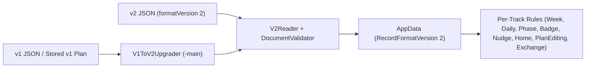

## Summary

Explicit **Tracks** (`weekly` or `daily`) replace the single-rhythm `Plan` in Core, storage migration, and exchange (`formatVersion` 2), while keeping all existing screens operating on the main Track (`tracks[0]`) for PR 1 (spec: `docs/specs/a4-5-tracks.md`, ADR 0007).

```diff
 Plan (id, name, isActive, startDate, goal, goalDate, weightIncrementKg)
-├── weeklyTarget / streakMinWorkoutsPerWeek / streakCountsCustomWorkouts
-├── phases[]
+├── tracks[] (tracks[0] = main Track, must be weekly)
+│   ├── TrackRhythm.Weekly (weeklyTarget, streakMinWorkoutsPerWeek, streakCountsCustomWorkouts)
+│   ├── TrackRhythm.Daily  (dayDonePercent: 1..100, default 75)
+│   └── phases[] (per-Track week ranges & SessionOverrides)
 └── sessions[]
+    ├── trackId (required -> Track in same Plan)
+    ├── defaultDay: Sunday..Saturday | Daily (Daily iff daily Track)
+    └── type: Strength | Cardio | Body | Test | Mobility
```



- **Model & serialisation (tickets 01–02):** `Plan` holds `Tracks` (`TrackRhythm.Weekly` or `TrackRhythm.Daily`) and flat `Sessions` (`TrackId`, `DefaultDay.Daily`, `SessionType.Mobility`). `ExchangeFormat.CurrentVersion` is `2`; `V1Reader` upgrades v1 Plans via `V1ToV2Upgrader` into a single weekly Track (`<planId>-main`, `"Main"`). `DocumentValidator` enforces all Track, cadence, `unknown_track`, benchmark-on-main-Track, per-Track `PhaseRanges`, and daily Session rules.
- **Stored-data migration (ticket 03):** `StartupReader` and `AppData.Migration` (`UpgradeIfOlderAsync`) deterministically rewrite stored v1 Plans into v2 Track records (`RecordFormatVersion = 2`), failing safe to `CannotRead` on write errors or quarantined records.
- **Per-Track rules & editing (tickets 04–08):** `WeekRules`, `PhaseRules`, `WeekScheduleRules`, `WeekRearrangement`, `DailyTrackRules`, `BadgeRules` (`streak:<id>`, `days:<id>`, `bestweek:<id>`), `NudgeRules`, `HomeViewBuilder` (`DailyTracks`, `ExtraWeekLines`), and the Editors Core rules (`PlanSettingsRules`, `TrackEditRules`, `PlanPhaseRules`, `SessionRowRules`, `PlanLifecycleRules`, `PlanSaveRules`, `WeekEditRules`) are Track-aware.
- **Exchange & whole loop (tickets 09–10):** Plan Import remaps colliding Track IDs across `Session.TrackId`, Phase overrides, and qualified Badge metrics; Export JSON/Markdown and `PromptPackFormat` carry two-Track format 2 examples; whole-loop tests verify identical rule results across v2, v1 Backup, and stored v1 datasets.

## Evidence

- **Before (v1 single-rhythm Plan):** Core 1,336, Ui 611, Web 39 tests (1,986 total).
- **After (v2 explicit Tracks, PR 1 tickets 01–10):** `dotnet build` 0 warnings, 0 errors; **Core 1,479, Ui 611, Web 39 tests passing (2,129 total, +143 new Core tests)**.

```text
Whole-loop equivalence (ApplyTests):
  for start in [v2 two-Track dataset, v1 Backup JSON, stored v1 records]:
    restored = Export(Backup) -> Restore(fresh AppData)
    assert identical before & after:
      WeekRules.Streak / CountedWorkouts
      DailyTrackRules.Status (Current, BestRun, DaysDone, TodayDone)
      PhaseRules.CurrentPhase / Position per Track
      BadgeRules.Progress (incl. streak:mobility)
      NudgeRules.Compute
      HomeViewBuilder.Build (Today, Line, Orbs, DailyTracks, ExtraWeekLines)
```

Changed expectations in existing tests (none loosened):
1. Format version bumped 1 -> 2 (`ExchangeFormatErrorTests`, `ParseThenValidateTests`, `WholeDatasetTests`, `ReadMeAndCultureTests`, `DataSpecConformanceTests`).
2. `AppDataMigrationTests`: replaced synthetic future-version placeholder tests with 12 real v1 -> v2 stored-record migration tests.
3. `ExportMarkdownTests`: Session headings under a Plan moved from `####` to `#####` under `#### <Track Name> (<cadence>)`.
4. `PromptPackTests`: updated to the two-Track `docs/data-spec.md` Plan example (`HYROX London` + `Morning mobility`).
5. `Ui.Tests/Pages/PlansTests`: `Other()` fixture given a distinct Track ID (`$"{id}-main"`) so two Plans in one snapshot do not share `"plan-main"`.

## Merge Danger

**Door:** One-way (for stored data and new Backups)

`AppData` migrates stored v1 Plans to `RecordFormatVersion = 2` on startup, and Backups written from this build use `formatVersion: 2` (which older v1 builds reject with `unsupported_version`). V1 Backups and Plan files continue to read and import through `V1Reader` + `V1ToV2Upgrader`, and the migration fails safe (leaving stored records untouched and starting as `CannotRead` if a write fails or a record is quarantined).

**Blast Radius:** Medium

Touches the `Plan` and `Session` domain models, JSON serialisation/validation, startup migration, all Plan-scoped Core rules, and Exchange, while keeping existing Razor pages pinned to `TrackRules.Main(plan)` until PR 2 exposes multi-Track UI.
